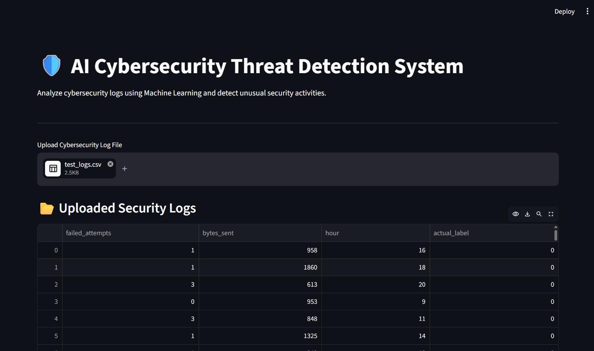
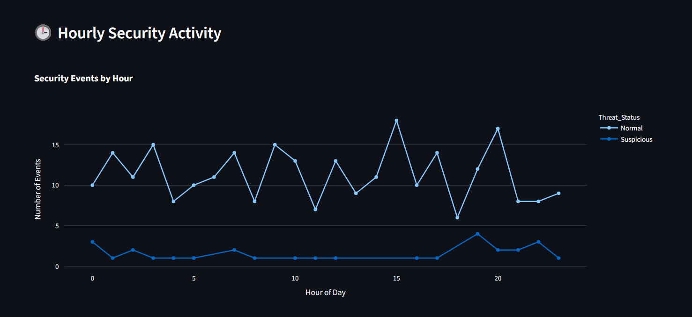
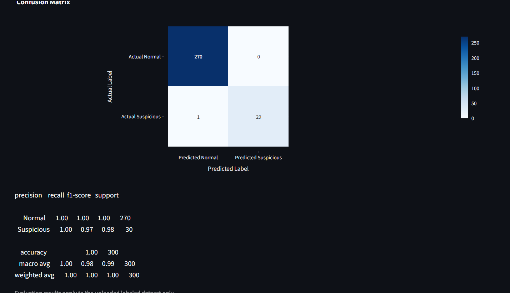

# 🛡️ AI Cybersecurity Threat Detection System

**Machine Learning-Based Security Log Analysis and Anomaly Detection Using Python, Isolation Forest, and Streamlit**

An AI-powered cybersecurity monitoring dashboard that analyzes security log data, identifies anomalous activities, assigns threat severity levels, and visualizes potentially suspicious behavior through an interactive web interface.

## 📌 Project Overview

Cybersecurity systems generate large volumes of log data, making manual monitoring time-consuming and difficult.

This project demonstrates how machine learning and data visualization can assist security analysts in identifying unusual patterns in security logs.

The application combines an Isolation Forest anomaly detection model with rule-based threat explanations and an interactive Streamlit dashboard.

**Note:** This is an educational prototype evaluated using synthetic security log data. It is not a production-ready intrusion detection system.

## 🎯 Objectives

- Detect anomalous activity in security logs using machine learning.
- Analyze failed login attempts, data transfer volume, and activity time.
- Categorize suspicious activities by threat severity.
- Identify potentially suspicious IP addresses.
- Visualize hourly security activity and detection results.
- Generate downloadable analysis reports.

## 🚀 Key Features

| Feature | Description |
|---|---|
| AI-Based Anomaly Detection | Uses Isolation Forest to identify unusual log patterns |
| CSV Log Upload | Allows users to upload security log datasets |
| Threat Severity Analysis | Assigns severity levels using rule-based logic |
| Threat Explanations | Provides descriptions of potentially suspicious behavior |
| IP Address Analysis | Highlights IP addresses associated with suspicious activity |
| Activity Visualization | Displays charts and hourly activity trends |
| Model Evaluation | Includes confusion matrix and classification metrics |
| Report Generation | Supports downloading analyzed results |

## 🛠️ Technology Stack

| Category | Technologies |
|---|---|
| Programming Language | Python |
| Machine Learning | Scikit-learn, Isolation Forest |
| Data Processing | Pandas, NumPy |
| Dashboard | Streamlit |
| Visualization | Python visualization libraries |
| Model Storage | Joblib / Pickle |
| Development Environment | Visual Studio Code |
| Version Control | Git and GitHub |

## 🧠 Machine Learning Approach

The project uses **Isolation Forest**, an unsupervised machine learning algorithm designed for anomaly detection.

The model analyzes three numerical features:

- `failed_attempts` — Number of failed login attempts
- `bytes_sent` — Amount of outgoing data
- `hour` — Hour of recorded activity

The trained model predicts whether a log entry is normal or anomalous.

The dashboard combines these predictions with rule-based logic to provide additional threat severity information.

### Workflow

1. Generate or upload security log data.
2. Preprocess the dataset.
3. Extract the required numerical features.
4. Apply the trained Isolation Forest model.
5. Identify anomalous log entries.
6. Assign severity levels and explanations.
7. Display results in the Streamlit dashboard.
8. Download the analysis report.

## 📊 Dashboard Screenshots

### AI Cybersecurity Dashboard



### Hourly Security Activity



### Machine Learning Confusion Matrix



## 📈 Model Evaluation

The improved Isolation Forest model was evaluated on a synthetic test dataset containing 300 records.

| Metric | Result |
|---|---|
| Test Samples | 300 |
| Normal Samples | 270 |
| Suspicious Samples | 30 |
| Accuracy | 99.67% |
| Suspicious-Class Precision | 100% |
| Suspicious-Class Recall | 96.67% |
| Suspicious-Class F1-Score | 98.31% |

### Confusion Matrix

| | Predicted Normal | Predicted Suspicious |
|---|---:|---:|
| Actual Normal | 270 | 0 |
| Actual Suspicious | 1 | 29 |

**Evaluation limitation:** These results were obtained from synthetically generated data. They should not be interpreted as evidence of equivalent performance on real-world network traffic or enterprise security logs. Further testing on representative, independently collected datasets is required.

## 📁 Project Structure

```text
AI-Cybersecurity-Threat-Detection/
│
├── data/
│   ├── realistic_train.csv
│   ├── realistic_test.csv
│   └── ...
│
├── models/
│   ├── improved_threat_model.pkl
│   └── threat_model.pkl
│
├── screenshots/
│   ├── dashboard.png
│   ├── hourly_activity.png
│   └── confusion_matrix.png
│
├── app.py
├── preprocessing.py
├── generate_dataset.py
├── generate_realistic_logs.py
├── generate_test_data.py
├── train_model.py
├── train_improved_model.py
├── evaluate_model.py
├── evaluate_improved_model.py
├── requirements.txt
├── .gitignore
└── README.md
```

## ⚙️ Installation and Setup

### 1. Clone the repository

```bash
git clone https://github.com/Bila-16/AI-Cybersecurity-Threat-Detection.git
cd AI-Cybersecurity-Threat-Detection
```

### 2. Create a virtual environment

```bash
python -m venv venv
```

### 3. Activate the virtual environment

On Windows PowerShell:

```powershell
.\venv\Scripts\Activate.ps1
```

### 4. Install dependencies

```bash
pip install -r requirements.txt
```

### 5. Run the Streamlit application

```bash
streamlit run app.py
```

Open the local URL shown in your terminal, typically:

`http://localhost:8501`
           or
 ## 🌐 Live Application

Try the AI Cybersecurity Threat Detection Dashboard:

[🚀 Launch Live Dashboard](https://ai-cybersecurity-threat-detection-bila.streamlit.app/)          

### 6. Test the dashboard

Upload a compatible sample CSV file from the `data` folder and explore the anomaly predictions, severity analysis, visualizations, and downloadable reports.

## 🔮 Future Enhancements

- Evaluate the model using real-world, appropriately anonymized cybersecurity datasets.
- Compare Isolation Forest against other anomaly detection algorithms.
- Support additional security log formats.
- Introduce real-time log ingestion.
- Add automated alerts for high-severity anomalies.
- Improve explainability and reduce false positives.
- Deploy the dashboard as an online demonstration.

## 👩‍💻 Author

**Bila Binoy**

Computer Science and Engineering Graduate | AI/ML and Cybersecurity Enthusiast

GitHub: [Bila-16](https://github.com/Bila-16)

## 📄 Disclaimer

This project is intended for educational, research, and portfolio demonstration purposes. Anomalies identified by the model are not necessarily confirmed cybersecurity attacks.
